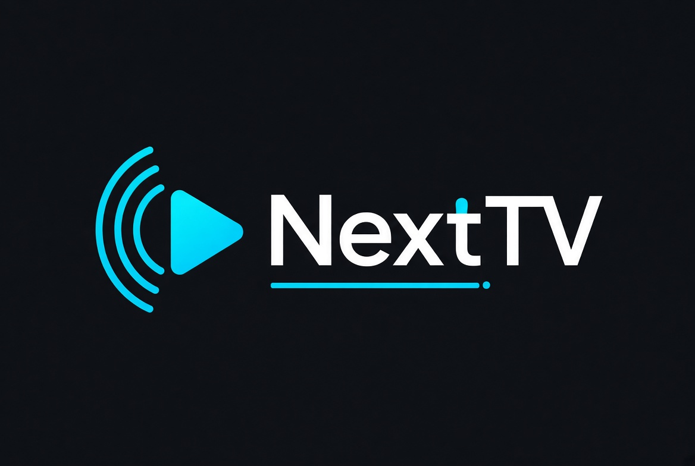

# NextTV

**Android TV 端现代化 IPTV 播放器**

基于 [Bolt-IPTV](https://github.com/AaronHvang/Bolt-IPTV) 的核心思路，使用 **Jetpack Compose for TV** 重写，面向类 [APTV](https://apps.apple.com/app/aptv) 的观感与换台体验。

> 闪电流转 · 秒速畅播 · 电视遥控器原生体验

---

## 功能特性

| 能力 | 说明 |
|------|------|
| **双播放器预热换台** | 主/备 ExoPlayer 热切换，减少黑屏（思路来自 Bolt-IPTV） |
| **实时预览** | 焦点落在频道卡片时静音预览当前画面 |
| **预览 Debounce** | 默认 250ms，快速滑动不疯狂切源 |
| **首帧缓存** | LRU 缓存预览帧，再次聚焦先显示缓存再出实时画面 |
| **自适应网格** | 按屏幕宽度 3–6 列 |
| **EPG** | XMLTV 解析；卡片显示当前节目；独立节目表页 |
| **扫码加源** | 局域网 Web 服务 + 二维码，手机提交 M3U |
| **M3U 解析** | 支持常见 `#EXTINF` 属性 |

---

## 原始项目与致谢

本项目的双播放器预热、整体产品方向大量参考了：

- **[Bolt-IPTV](https://github.com/AaronHvang/Bolt-IPTV)**（AaronHvang）— 开源 Android IPTV 播放器，GPL-3.0

界面与交互另参考了 Apple TV 上的 APTV 体验。NextTV 为独立实现，并非 Bolt-IPTV 的官方分支。

若你使用或修改本项目，请同时尊重 [Bolt-IPTV 的许可证](https://github.com/AaronHvang/Bolt-IPTV/blob/main/LICENSE) 要求。

---

## 品牌

| 资源 | 路径 |
|------|------|
| 应用图标 | `assets/branding/nexttv_icon_512.png` |
| 横幅 Logo | `assets/branding/nexttv_banner.jpg` |

<p align="center">
  
</p>

<p align="center">
  
</p>

## 截图 / 体验路径

1. 打开应用 → 侧边栏 **设置**
2. **加载示例源**，或手机扫码提交自己的 M3U
3. （可选）加载示例 EPG
4. 回首页用遥控器浏览；焦点卡片可预览；确认键全屏播放
5. 全屏时上下键换台

---

## 技术栈

- Kotlin 2.0
- Jetpack Compose for TV（`androidx.tv:tv-material`）
- Media3 / ExoPlayer
- Coil、Coroutines / StateFlow
- NanoHTTPD + ZXing（扫码加源）

---

## 快速开始

### 环境

- Android Studio Ladybug (2024.2+) 或更新
- JDK 17
- Android SDK 35
- 建议内存 ≥ 8GB

### 编译运行

```bash
git clone https://github.com/Ringas/NextTV.git
cd NextTV

# 配置本机 SDK（Android Studio 一般会自动生成）
echo "sdk.dir=/path/to/Android/Sdk" > local.properties

./gradlew :app:assembleDebug
# APK: app/build/outputs/apk/debug/app-debug.apk

adb install -r app/build/outputs/apk/debug/app-debug.apk
```

更细的步骤见 [BUILD.md](BUILD.md)。

---

## 项目结构

```
app/src/main/java/com/bolttv/compose/
├── core/
│   ├── model/          # Channel、EPG、播放状态
│   ├── data/           # M3U / EPG / 扫码 WebServer
│   └── player/         # DualPlayerManager、PreviewPlayerManager
└── ui/
    ├── theme/
    ├── components/     # ChannelCard、QrCodeImage
    └── screens/        # Home / Player / Settings / EPG
```

---

## 开发文档

- [开发说明与架构](docs/DEVELOPMENT.md) — 模块说明、进度、Roadmap
- [编译安装](BUILD.md)

---

## 版本

当前：**v0.3.0**（功能骨架，可本地编译调试）

详见 [docs/DEVELOPMENT.md](docs/DEVELOPMENT.md) 中的进度表与计划。

---

## 声明

- NextTV 是**播放器工具**，不提供、不内置任何直播源。
- 请仅使用你拥有合法授权的 M3U / Xtream / EPG。
- 示例源（iptv-org 等）仅便于开发自测，请勿用于生产或商业分发。

---

## License

建议与上游一致采用 **GPL-3.0**（因核心思路与可对照实现来自 Bolt-IPTV）。  
若你二次分发，请自行核对依赖库许可证并保留致谢与版权声明。
